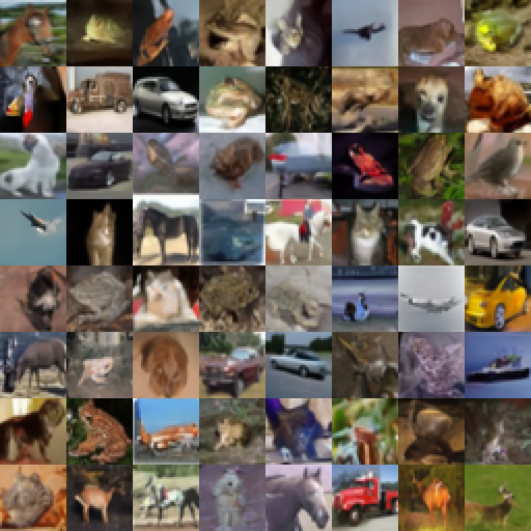

# Разные методы генерации из диффузионных моделей

Промежуточный отчёт. Этап 1: постановка задачи, данные и baseline.

## 1. Постановка задачи и ограничения

Цель проекта — исследовать компромисс между качеством и вычислительной стоимостью генерации готовой диффузионной модели. На этапе 1 воспроизводится детерминированный DDIM из Diffusers, проверяется интерфейс модели и формируется протокол будущего сравнения с DPM-Solver++ второго порядка и Heun по схеме EDM. Обучение и изменение весов не выполняются.

Основные оси оценки: FID, визуальное качество, число вызовов UNet на изображение (NFE) и фактическое время генерации. Время поиска расписания учитывается отдельно. Ограничение масштаба — изображения 32×32, одна готовая модель, float32 и последовательная обработка батчей. Устройство прогона: {{HARDWARE}}; backend {{DEVICE}}. Код также поддерживает CUDA и CPU.

## 2. Данные и предобученная модель

**CIFAR-10 [1].** Датасет содержит 60 000 цветных изображений 32×32: 50 000 train и 10 000 test, десять классов. В baseline используются {{NUM_REAL}} изображений test; train не применяется для обучения или подбора настроек. Индексы зафиксированы в `real_indices.json`, seed порядка — 1701. Классовые метки в безусловную модель не передаются.

Тестовая часть загружена из Parquet-версии `uoft-cs/cifar10` организации University of Toronto на Hugging Face, ревизия `0b2714987fa478483af9968de7c934580d0bb9a2`. Проверены размер 10 000, разрешение 32×32 и по 1000 изображений каждого класса. SHA256 файла и пикселей сохранены в результатах; декодирование выполняется без resize.

**Модель [2].** Используется безусловная DDPM `google/ddpm-cifar10-32`, {{PARAMS}} параметров. Выбор обусловлен готовыми весами, небольшим разрешением и совместимостью с Diffusers. Зафиксирована ревизия `267b167dc01f0e4e61923ea244e8b988f84deb80`. UNet работает в режиме eval, градиенты отключены, все веса заморожены. Разбиение CIFAR-10 не означает независимости от исходного обучения готового чекпоинта; его история принимается из карточки модели.

**Условия использования.** Для весов модели и кода Diffusers указана Apache-2.0. На официальной странице CIFAR-10 отдельная лицензия данных не указана; источник цитируется, полный датасет в репозиторий не включён. Использование готового экстрактора Inception и его версия также зафиксированы. В репозитории сохраняются метрики, индексы и небольшие иллюстрации; крупные веса и тензоры загружаются или восстанавливаются запуском кода.

**Объём baseline.** {{NUM_GENERATED}} начальных шумов создаются на CPU одним генератором PyTorch с seed 20261105. Тензор `noise.pt` фиксируется до разбиения на батчи. Контрольная сумма SHA256: `{{NOISE_SHA}}`. Отдельные наборы для подбора и проверки расписаний определены в разделе 8.

<!-- pagebreak -->

## 3. Согласование модели и сэмплера

Обозначим A(t) = произведение (1 − beta[k]) от k=0 до t, alpha(t)=sqrt(A(t)), sigma_VP(t)=sqrt(1−A(t)). Прямой процесс имеет вид x_t = alpha(t) x_0 + sigma_VP(t) epsilon. В выбранном чекпоинте 1000 дискретных шагов t=0,…,999 и линейные beta от 0.0001 до 0.02 [2].

UNet принимает вещественный тензор `[B,3,32,32]` и индекс t исходной обучающей сетки. Результат — epsilon_theta(x_t,t), тензор той же формы. Номер итерации сокращённого сэмплера не подставляется вместо исходного t. Реальные пиксели для определения прямого процесса соответствуют диапазону [−1,1]; при безусловной генерации входом служит стандартный нормальный шум.

Преобразования основных параметризаций реализованы в `prediction_to_x0` и проверены на синтетической паре «чистое изображение — шум»:

- Предсказание epsilon: x0_hat = (x_t − sigma_VP epsilon_hat) / alpha.
- Предсказание x0 (`sample`): x0_hat = model_output.
- Предсказание v = alpha epsilon − sigma_VP x0: x0_hat = alpha x_t − sigma_VP v_hat. Обратно epsilon_hat = sigma_VP x_t + alpha v_hat.

В данном baseline используется только epsilon. Переключение флага на v без соответствующего обучения весов было бы некорректным. Для DDIM применяется готовый `scheduler.step`; собственный код организует явные начальные шумы, цикл и измерения.

### Переход к нотации EDM

Для применения Heun к той же VP-модели вводятся y=x_t/alpha и sigma_EDM=sigma_VP/alpha. Тогда y=x0+sigma_EDM epsilon, а вход DDPM восстанавливается как x_t=y/sqrt(1+sigma_EDM²). Денойзер имеет вид D(y,sigma)=y−sigma epsilon_theta(x_t,t(sigma)). Переход не превращает DDPM в чекпоинт, обученный с EDM-preconditioning [5].

На этапе 2 t(sigma) будет определяться интерполяцией log(sigma_EDM) по исходной сетке с ограничением диапазона; масштаб входа и дробный t будут проверяться отдельно. Общий начальный шум z означает x_T=z и y_T=z/alpha(T), что сохраняет один старт при смене координат. На этапе 1 преобразование VP→EDM проверено алгебраически; интегратор Heun пока не реализуется.

### Конкретные настройки baseline

{{STEPS}} шагов DDIM, `eta=0`, `leading`, `steps_offset=0`, `clip_sample=true`, `set_alpha_to_one=true`, `use_clipped_model_output=false`. Для 50 шагов сетка равна 980,960,…,0; после t=0 используется граничное A=1. Ограничение x0_hat диапазоном [−1,1] выполняет scheduler; направление шага использует исходное предсказание epsilon. Выход преобразуется в [0,1], затем округляется в uint8 для FID. Все эти соглашения существенны для воспроизводимости.

<!-- pagebreak -->

## 4. Теоретическая база методов

### DDIM [3]

DDIM использует готовое предсказание модели и допускает пропуск промежуточных обучающих шагов. При eta=0 переход детерминирован: один начальный шум задаёт всю траекторию. Для перехода t→s, где s<t, сначала вычисляется x0_hat, затем:

`x_s = alpha(s) x0_hat + sigma_VP(s) epsilon_hat`.

В baseline x0_hat ограничивается согласно конфигурации. При eta>0 появляется дополнительная случайная составляющая; здесь она отключена. На каждый переход требуется один вызов модели. Уменьшение числа переходов ускоряет генерацию, но увеличивает ошибку дискретизации. Варьируется сетка инференса, а не расписание beta исходного обучения.

### Многошаговый DPM-Solver++ второго порядка [4]

Метод решает диффузионное ODE в параметризации предсказания данных. Предсказание epsilon сначала преобразуется в x0_hat. Вводится lambda=log(alpha/sigma_VP). Текущее и предыдущее предсказания используются для оценки изменения денойзера без второго вызова сети на том же шаге.

Для варианта midpoint: h=lambda_next−lambda_i, r=(lambda_i−lambda_prev)/h, D0=x0_hat_i, D1=(x0_hat_i−x0_hat_prev)/r. Шаг записывается как:

`x_next = (sigma_VP_next / sigma_VP_i) x_i`

`         − alpha_next (exp(−h)−1) (D0 + D1/2)`.

Первый шаг выполняется первым порядком, поскольку истории ещё нет. В окрестности нулевого конечного sigma требуется отдельная обработка последнего шага; деление на ноль в lambda недопустимо. Для проверки на этапе 2 используется `DPMSolverMultistepScheduler`, `algorithm_type=dpmsolver++`, `solver_order=2`, `solver_type=midpoint`, с явно согласованными конечными условиями.

### Heun в координатах EDM [5]

При нулевом stochastic churn решается dy/dsigma=(y−D(y,sigma))/sigma. Для d_i=(y_i−D_i)/sigma_i и Delta=sigma_next−sigma_i выполняется пробный Euler-шаг y_E=y_i+Delta d_i. После второго вызова модели вычисляется d_E, а итог равен y_next=y_i+Delta(d_i+d_E)/2. При sigma_next=0 используется только Euler-шаг, чтобы исключить деление на ноль.

| Метод | Используемая информация | NFE |
|---|---|---|
| DDIM, eta=0 | Текущее epsilon или x0 | K переходов → K вызовов |
| DPM-Solver++ 2M | Текущее и предыдущее x0 | K переходов → K вызовов |
| Heun, churn=0 | Два наклона на переход | K переходов до нуля → 2K−1 |

Поэтому одинаковое число шагов не обеспечивает равный вычислительный бюджет. На этапе 2 сравниваются фактически подсчитанные NFE; DDIM, DPM-Solver++ и Heun должны получать согласованные шумы, диапазоны sigma и политику ограничения предсказаний.

<!-- pagebreak -->

## 5. Воспроизведение baseline и результаты

{{RESULT_STATUS}}

Окружение прогона: Python {{PYTHON_VERSION}}, PyTorch {{TORCH_VERSION}}, Diffusers {{DIFFUSERS_VERSION}}, float32. Полный список версий и контрольные суммы приведены в JSON.

| Показатель | Фактическое значение |
|---|---|
| Модель и сэмплер | DDPM CIFAR-10 + Diffusers DDIM |
| Размер выборки для FID | {{NUM_GENERATED}} generated / {{NUM_REAL}} test |
| Шаги / NFE на изображение | {{STEPS}} / {{NFE}} |
| Вызовы UNet с батчами | {{BATCH_CALLS}} |
| Время генерации всей выборки | {{GEN_SECONDS}} с ({{GEN_MINUTES}} мин) |
| Среднее время на изображение | {{SECONDS_IMAGE}} с |
| FID, Inception 2048 | {{FID}} |
| Время оценки FID | {{FID_SECONDS}} с |
| Проверка по DDIMPipeline | max abs error = {{PIPELINE_ERROR}} |

{{VISUAL_ANALYSIS}}

Первые 64 реальных изображения сохранены отдельно в `real_grid.png`. Выборка 2048 generated существенно меньше стандартных 50 000, поэтому FID рассматривается как оценка учебного baseline. Число из оригинальной статьи DDPM не является целевым значением этого прогона: отличаются сэмплер, число шагов, размер и разбиение выборки.

<!-- pagebreak -->

## 6. Метрики и протокол оценки

FID [6] вычисляется по 2048-мерным признакам TF-совместимого Inception из `torch-fidelity` [7]:

`FID = ||mu_r−mu_g||² + Tr(C_r+C_g−2(C_r C_g)^(1/2))`.

Используются RGB uint8 без внешнего resize или нормализации ImageNet; внутреннее преобразование выполняет экстрактор. Средние и ковариации рассчитываются в float64 на CPU. Извлечение признаков выполняется на {{DEVICE}}. FID отражает близость распределений признаков, но не совпадение отдельных изображений и не гарантирует разнообразие сам по себе.

{{FID_VERIFICATION}}

На этапе 1 проведён один прогон FID с фиксированным набором шумов. Три повтора короткого benchmark после прогрева характеризуют время, а не статистическую неопределённость FID. Время генерации суммируется по {{BATCH_COUNT}} батчам размера до {{BATCH_SIZE}}; перед и после каждого измерения выполняется синхронизация устройства. Загрузка весов, прогрев, копирование исходного шума, округление в uint8 и запись на диск исключены. Цикл денойзинга и преобразование в float [0,1] включены. {{BENCHMARK_DESCRIPTION}}

Число вызовов подтверждается forward-hook на UNet. Отдельно учитываются NFE на изображение, число вызовов батчами и {{SAMPLE_EVALUATIONS}} обработанных пар «изображение–шаг». Проверка по готовому pipeline проводится на двух одинаковых шумах и четырёх шагах; контрольный порог max abs error — 2e−5. Также проверены преобразования epsilon/x0/v и известные аналитические случаи FID.

## 7. План сравнения на этапе 2

Начальная матрица: 3 сэмплера × 2 бюджета NFE (19 и 39) × 2 стандартных расписания (равномерное по исходному t и Karras rho=7) = 12 конфигураций. Для Heun это 10 и 20 переходов с последним Euler-шагом. Затем добавляются 6 конфигураций с подобранными расписаниями: по одной на пару «сэмплер — бюджет». Всего 18 конфигураций.

Сначала все конфигурации проверяются на 128 отдельных валидационных шумах по MSE к длинной траектории и визуальным примерам. Для полного FID выбираются 6: лучший стандартный и подобранный вариант каждого сэмплера при NFE=39. План — три независимых набора по 2048 шумов (seeds 20261105, 20261106, 20261107), одинаковых между конфигурациями; приводятся среднее и стандартное отклонение FID. Для времени — прогрев и три повтора одинаковых батчей. Размер тестовой выборки CIFAR-10 остаётся 10 000.

Критерий корректности — согласие собственных шагов с Diffusers при одинаковых соглашениях. Критерий улучшения расписания — снижение MSE на новых шумах при том же NFE, без явной визуальной деградации. Более низкий FID рассматривается как отдельная проверяемая гипотеза, а не гарантированное следствие меньшего MSE. Затраты подбора в скорость инференса не включаются и публикуются отдельно.

<!-- pagebreak -->

## 8. План подбора расписания

Опорный результат — DDIM с eta=0 и 1000 шагами при том же исходном z. Для поиска выделяются 64 шума с seed 3101; для выбора числа проходов и ранней остановки — 128 шумов с seed 3102. Они не используются в итоговом FID. Эталонные изображения рассчитываются один раз и кэшируются. Целевая функция — средняя MSE конечных изображений в float [0,1] относительно этого эталона.

Планируется координатный поиск пяти внутренних опорных log(sigma), начально взятых из стандартного расписания. Конечные уровни фиксированы; промежуточные уровни восстанавливаются линейной интерполяцией в log(sigma) по нормированному номеру перехода. Для очередной опоры проверяются сдвиги ±delta и исходное положение. Принимается вариант с меньшей MSE на подборочных шумах; порядок опор и положительный минимальный зазор сохраняются. После прохода delta уменьшается вдвое; максимум три прохода. Из допустимых состояний выбирается лучшее на валидации. Полное число кандидатов и время поиска сохраняются.

Гипотеза: ближе к низким уровням шума могут потребоваться более частые шаги для восстановления мелких деталей; другая возможная зона чувствительности — начало формирования структуры. Это предположение проверяется по распределению найденных уровней и локальному росту MSE при удалении шагов, без заранее заданного вывода. Новые тестовые шумы выявят переобучение расписания. Перенос между сэмплерами проверяется через интерполяцию тех же нормированных опор на нужное число переходов с сохранением NFE; отдельно показывается результат до повторной настройки.

## 9. План реализации, ожидаемые результаты и риски

Последовательность этапа 2: реализация и проверка DDIM; история предсказаний и граничные шаги DPM-Solver++; VP/EDM-адаптер и Heun; стандартные расписания; координатный поиск; независимая оценка и анализ. Ожидаемый результат — таблица FID/NFE/времени, график качества относительно бюджета, распределение уровней шума и примеры удачных и неудачных генераций.

Основные риски: ошибка масштаба входа или t, различия clipping и конечных условий, переобучение на подборочных шумах, смещение FID малой выборки и несовпадение улучшений MSE/FID. Снижаются проверками по Diffusers, раздельными шумами, одинаковыми условиями и сохранением всех конфигураций. При ограничении GPU сначала сокращается число предварительных конфигураций, а изменение итогового протокола явно фиксируется. Численные результаты этапа 2 в настоящем отчёте отсутствуют.

## 10. Источники

[1] Krizhevsky. CIFAR-10: https://www.cs.toronto.edu/~kriz/cifar.html; версия данных: https://huggingface.co/datasets/uoft-cs/cifar10

[2] Google DDPM CIFAR-10: https://huggingface.co/google/ddpm-cifar10-32

[3] Song et al. DDIM, ICLR 2021: https://arxiv.org/abs/2010.02502

[4] Lu et al. DPM-Solver++: https://arxiv.org/abs/2211.01095

[5] Karras et al. EDM, NeurIPS 2022: https://arxiv.org/abs/2206.00364

[6] Heusel et al. FID, NeurIPS 2017: https://arxiv.org/abs/1706.08500

[7] torch-fidelity: https://github.com/toshas/torch-fidelity

[8] Diffusers 0.35.2: https://github.com/huggingface/diffusers/tree/v0.35.2
